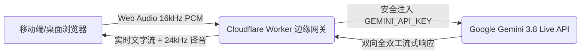

# Gemini 实时双语同传 (Gemini Live Translator)

基于 **Google Gemini 3.8 Multimodal Live API** 与 **Cloudflare Workers** 边缘计算构建的极低延迟全双工实时双语同传系统。

## 🌟 核心特性

- **端到端极低延迟**：通过 WebSocket 直接将 16kHz PCM 裸音频流式送入 Gemini 原生多模态模型，无需多重级联分词，端到端延迟仅数百毫秒。
- **全平台移动端自适应**：
  - 针对手机端（iOS Safari / Android Chrome）专项优化，采用 `100dvh` 视口控制，消除整页滚动与双滚动条干扰。
  - 内置 Web Audio 移动端手势自动解锁机制，原生支持移动端麦克风与音频流式播放。
- **倒序时间流呈现**：最新发言与翻译始终置顶在屏幕最上方，无需手动翻页滚动。
- **双语实时对照**：同传卡片实时呈现“🗣️ 原文识别”与“🌐 译文流式涌现”。
- **5 款男女声同传发音**：
  - 👩 `Aoede`（女声 · 轻松亲切，推荐）
  - 👩 `Kore`（女声 · 沉稳专业）
  - 👨 `Charon`（男声 · 磁性稳重，会议首选）
  - 👨 `Puck`（男声 · 阳光活力）
  - 👨 `Fenrir`（男声 · 浑厚饱满）
- **安全云端中继（零泄露风险）**：
  - 前端不暴露任何 API Key。
  - 生产环境由 Cloudflare Worker 在边缘节点安全代理 Google WebSocket 连接。

## 🛠️ 技术架构



- **前端**：Vanilla HTML5 + Modern CSS + Web Audio API（AudioWorklet / ScriptProcessor）
- **后端中继**：Cloudflare Workers（内核级全双工 WebSocket 直通中继）
- **AI 引擎**：Google Gemini 3.8 Live (`models/gemini-3.8-live`)

## 🚀 线上体验

- **生产版地址**：[https://gemini-live-translator.chinanetysj.workers.dev](https://gemini-live-translator.chinanetysj.workers.dev)

## 💻 本地运行与部署

### 1. 本地开发
```bash
# 启动本地开发服务
node server.mjs
# 访问 http://localhost:3000
```

### 2. Cloudflare 部署
双击根目录下的 `deploy.bat` 脚本，即可全自动同步发布 Worker 中继与前端静态资源。

## 📄 License
MIT
